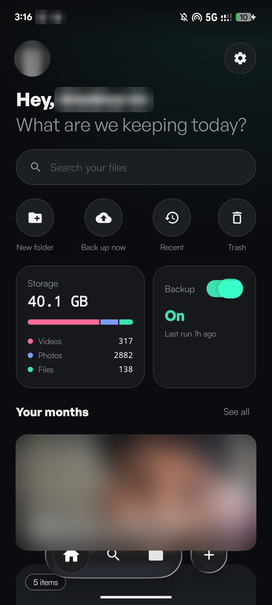
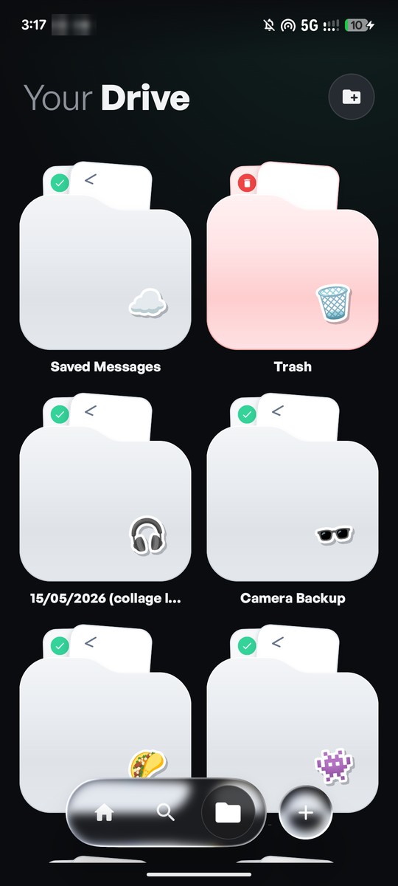
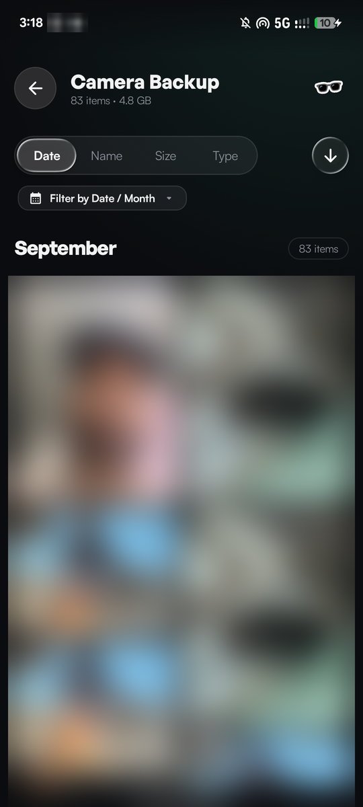
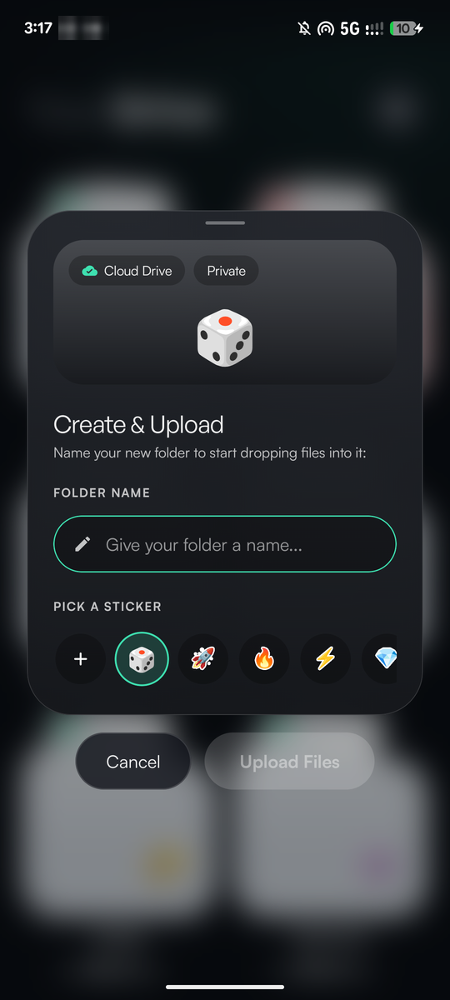
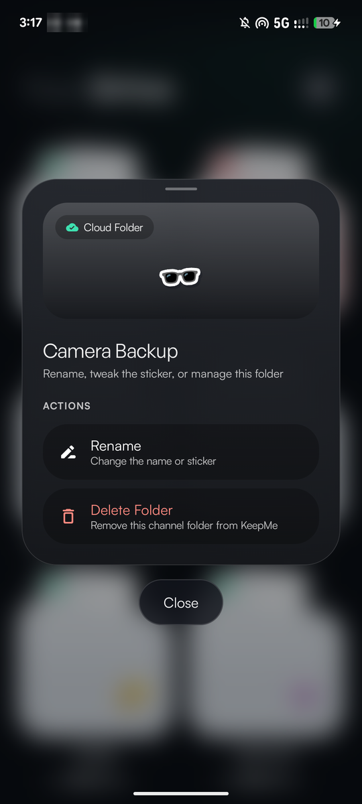
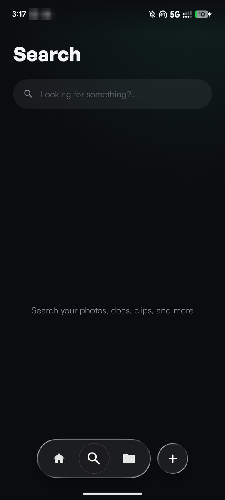
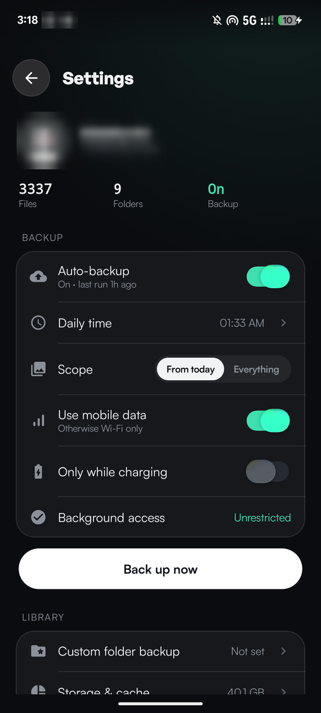

<p align="center">
  
</p>

<h1 align="center">KeepMe — Telegram cloud storage for Android</h1>

<p align="center">
  <strong>Turn your Telegram account into a personal cloud drive: back up photos and videos, organise files in folders, and browse everything in a fast native app.</strong><br/>
  Free, open source, no servers, no subscription. Built with Kotlin, Jetpack Compose and TDLib.
</p>

<p align="center">
  <a href="https://github.com/3v3nera/KeepMe/releases/latest"></a>
  <a href="https://github.com/3v3nera/KeepMe/stargazers"></a>
  <a href="LICENSE"></a>
  
</p>

<p align="center">
  
  
  
</p>

---

## What is KeepMe?

KeepMe is an open-source Android app that uses **your own Telegram account as cloud storage**. Photos, videos, documents, music and APKs are stored in Telegram's cloud, in your **Saved Messages** and in **private channels that act as folders**. KeepMe gives that storage a proper drive interface: folders, a month-by-month photo gallery, search, trash, automatic camera backup and a built-in video and image viewer.

If you have been looking for a **Telegram Drive for Android**, a **free Google Photos / Google Drive alternative**, or a way to **back up your phone camera to Telegram**, this is it.

> KeepMe is an independent project and is **not affiliated with or endorsed by Telegram**.

## Screenshots

<p align="center">
  
  
  
  
</p>
<p align="center">
  
  
  
</p>

<sub>Screenshots are from a real device; personal details and photos are blurred.</sub>

## Features

**Storage that lives in Telegram**
- Store photos, videos, documents, audio, APKs and archives in your own Telegram cloud. Files up to Telegram's per-file limit (2 GB, or 4 GB with Telegram Premium).
- **Folders** are private Telegram channels created and managed by the app. The technical `[TG]` tag is hidden in the UI. Rename, re-sticker or delete a folder with a long-press.
- **Saved Messages** is your root drive.

**Photos and gallery**
- **Photos are grouped by the date they were taken**, read from EXIF and camera file names (`PXL_`, `IMG_`, `VID_`, `Screenshot_`, WhatsApp, Signal), not by upload date.
- Masonry gallery that keeps each photo's real aspect ratio, with sorting by date, name, size or type, and a month filter.
- Full-screen viewer with pinch-to-zoom, swipe between items, swipe-down to close and a details sheet.
- Video **streams straight from Telegram** with Media3 ExoPlayer, no full download needed. Documents and PDFs open in the apps you already have.

**Automatic camera backup**
- Daily backup with WorkManager at a time you choose. Options: from today only or everything, Wi-Fi only, only while charging.
- One-tap **Back up now**, plus a custom-folder backup.

**Everyday drive features**
- Search across all your files with type filters and recent searches.
- Trash with a 30-day countdown, restore or restore all.
- Storage overview by file type, multi-select to share, download or delete.

**Design**
- Dark, near-black interface with a single emerald accent, bento-style cards and month cards, smooth spring animations, and a liquid-glass navigation bar built with AGSL shaders. Folders open with a shared-element animation.

**Private by design**
- Everything travels directly between your phone and Telegram over MTProto. There are no KeepMe servers, and the app contains no analytics or trackers.
- **Update check, in the open:** to find new versions, KeepMe joins the public Telegram channel `@siddTdrive` and reads its latest APK post. It does not read your files for this.
- You sign in with your phone number, the login code Telegram sends you, and your 2FA password if you have one. Your login stays on your device.

## Install

1. Download the latest APK from the **[Releases page](https://github.com/3v3nera/KeepMe/releases/latest)**.
2. Allow installs from your browser or file manager if Android asks, then open the APK.
3. Open KeepMe and sign in with your phone number. Telegram sends you a login code (and asks for your 2FA password if you set one).
4. Grant photo access if you want camera backup, and you are done.

Requires Android 7.1 (API 25) or newer.

## FAQ

**Is KeepMe really unlimited?**
Telegram does not publish a total storage cap for personal cloud chats, and KeepMe adds none. Each file is limited to Telegram's per-file size limit.

**Is it safe? Who can see my files?**
Files are stored in your Telegram account, in Saved Messages and in channels only you can access. KeepMe has no backend of its own. The code is open, so you can check it.

**Will it use my mobile data?**
Only if you allow it. Backup can be restricted to Wi-Fi and to charging in Settings.

**How does updating work?**
KeepMe checks the public Telegram channel `@siddTdrive` for a newer APK (you are joined to it automatically) and offers to download it. You can also just grab new builds from the [Releases page](https://github.com/3v3nera/KeepMe/releases/latest).

**Does it work without Telegram?**
No. Telegram is the storage. You need a Telegram account.

**Which Telegram API key does it use?**
Telegram requires every third-party app to use an API key. The published APK ships with one built in, so you only need your phone number. If you build from source you can use your own `api_id` and `api_hash` from [my.telegram.org](https://my.telegram.org): set them in `TelegramConfig.kt`, or leave them blank and the app will ask for them on first launch. Please also read Telegram's [API Terms of Service](https://core.telegram.org/api/terms) and use the app responsibly.

**Can I use it on iOS or desktop?**
Not yet. KeepMe is Android only.

## Build from source

Requirements: Android Studio (recent stable), JDK 17, Android SDK 36.

```bash
git clone https://github.com/3v3nera/KeepMe.git
cd KeepMe
./gradlew assembleDebug
```

The debug APK is written to `app/build/outputs/apk/debug/`. On Windows use `gradlew.bat`.

## Tech stack

| Area | Library |
| --- | --- |
| UI | Kotlin, Jetpack Compose, Material 3, shared-element transitions |
| Telegram engine | [TDLib](https://github.com/tdlib/td) via EasyTDLib (prebuilt native binaries) |
| Storage and cache | Room |
| Background work | WorkManager, foreground service |
| Media | Media3 ExoPlayer, Coil |
| Glass effects | Prismal (AGSL runtime shaders and RenderEffect blur) |
| DI | Hilt |

## Contributing

Bug reports, ideas and pull requests are welcome. Please open an [issue](https://github.com/3v3nera/KeepMe/issues/new/choose) first for larger changes. Project conventions live in [AGENTS.md](AGENTS.md).

## License

KeepMe is released under the [MIT License](LICENSE). TDLib is licensed under the Boost Software License 1.0. See [THIRD_PARTY_LICENSES.txt](THIRD_PARTY_LICENSES.txt).

<sub>Keywords: Telegram Drive, Telegram cloud storage, Telegram backup, Android photo backup, Google Photos alternative, Google Drive alternative, open source cloud storage, TDLib, Jetpack Compose.</sub>