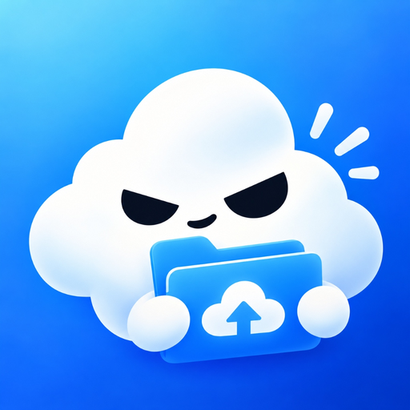
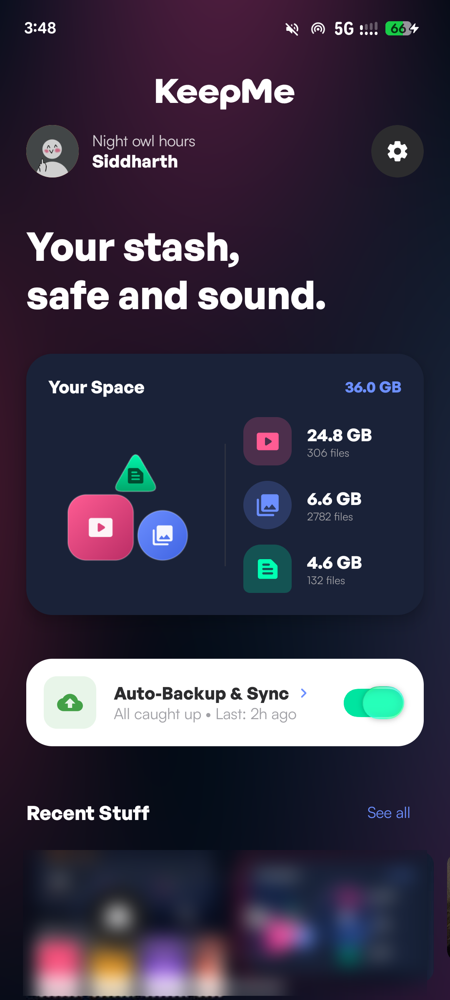
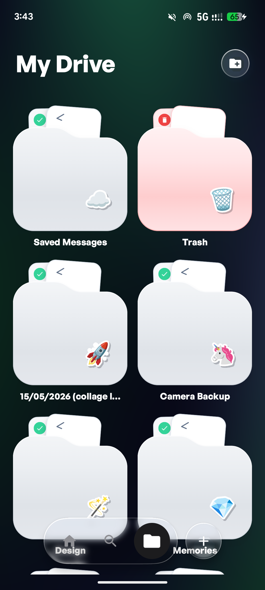
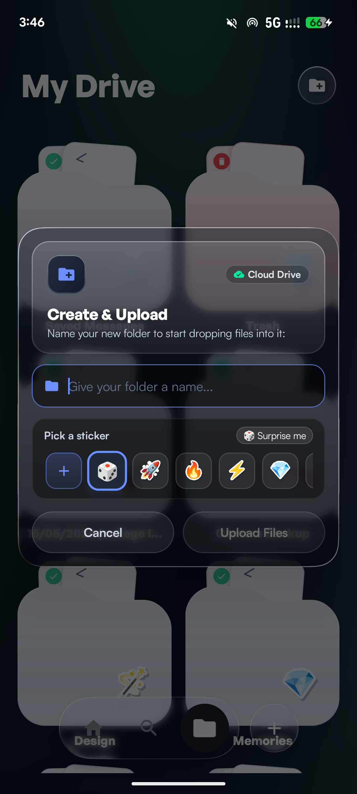
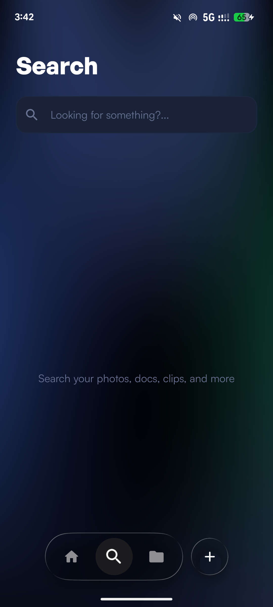
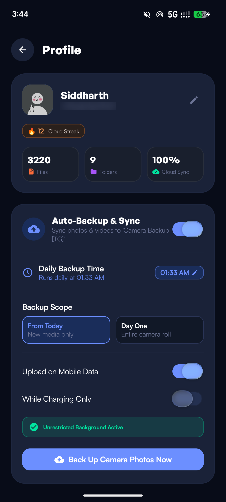

# 📱 KeepMe — Your Telegram Cloud Drive for Android

<p align="center">
  
</p>

<p align="center">
  <strong>Transform your personal Telegram account into unlimited, high-speed, secure cloud storage.</strong>
</p>

<p align="center">
  
  
  
  
  
</p>

---

## 🌟 Overview

**KeepMe** is a native Android cloud drive powered by **Kotlin**, **Jetpack Compose**, and **TDLib**. It connects directly to the Telegram MTProto network, turning private Telegram channels and your "Saved Messages" chat into a personal, unlimited cloud storage drive with seamless background camera backups and media streaming.

---

## 📸 Screenshots

<p align="center">
  
  &nbsp;
  
  &nbsp;
  
</p>
<p align="center">
  
  &nbsp;
  
</p>

---

## ✨ Key Features

- ☁️ **Unlimited Personal Storage**:
  - Store photos, 4K videos, documents, music, APKs, and archives of any size using Telegram's cloud architecture.
  - **Folders as Private Channels**: Create, rename, delete, and organize folders backed by private channels tagged with `[TG]`.
  - Clean in-app display: `[TG]` background tags are automatically hidden in your library.

- 📅 **Smart "Date Taken" Gallery Grouping**:
  - Automatically extracts the true capture time from EXIF metadata (`TAG_DATETIME_ORIGINAL`) and camera filenames (`PXL_`, `IMG_`, `VID_`, `Screenshot_`, `WhatsApp`, `Signal`, epoch timestamps).
  - Pre-uploaded and historical photos are chronologically grouped into monthly albums (e.g. *September*, *June*, *October 2025*, *January 2023*) instead of naive upload dates.
  - Seamless toggle: Sorting by Name or Size shows a flat list without dividing headers.

- 🔄 **Automated Camera Backup & Sync**:
  - Configurable daily scheduled backups using Android **WorkManager** and foreground services.
  - Selective backup scope: Choose between *"From Today Only"* or *"Day One (All Photos)"*.
  - Configurable network constraints: Wi-Fi only, Require Charging, and battery optimization exemptions.
  - One-tap *"Back Up Camera Photos Now"* trigger.

- 📐 **Solid Pseudo-Physics Storage Breakdown**:
  - Visual breakdown of your storage by file type (Videos, Photos, Docs).
  - Tangent resting geometry where shapes respect rigid physical boundaries with zero overlap.

- 🎬 **Direct Media Streaming & Previews**:
  - Watch videos directly from Telegram without waiting for full downloads using **Media3 ExoPlayer**.
  - High-res pinch-to-zoom image viewer with liquid glass metadata inspector.
  - Native document and PDF opening via Android's `ACTION_VIEW` and `FileProvider`.

- 🛡️ **100% Private & Open Source**:
  - Direct peer-to-cloud: All data travels strictly between your device and Telegram's official MTProto servers.
  - Users provide their own `api_id` and `api_hash` from [my.telegram.org](https://my.telegram.org).
  - Zero analytics, zero third-party tracking, and zero hidden servers.

---

## 🏗️ Architecture & Libraries

- **UI Framework**: Jetpack Compose + Material 3
- **Telegram Engine**: Precompiled native [TDLib](https://github.com/tdlib/td) (`arm64-v8a`, `armeabi-v7a`, `x86`, `x86_64`)
- **Database & Cache**: Android Room (with non-destructive migrations)
- **Background Sync**: Android WorkManager + Foreground Service
- **Video Playback**: AndroidX Media3 ExoPlayer
- **Image Pipeline**: Coil 3
- **Liquid Glass Shaders**: Prismal AGSL runtime shaders & RenderEffect blurs
- **Haptics**: Native vibration feedback engine

---

## 🚀 Getting Started

### 1. Prerequisites
- Android Studio Ladybug / Meerkat or newer
- Android SDK 26+ (Android 8.0+)
- JDK 17+

### 2. Telegram API Setup
1. Log in to [my.telegram.org](https://my.telegram.org).
2. Navigate to **API development tools** and create an app to obtain your `api_id` and `api_hash`.
3. Enter your credentials when launching KeepMe for the first time.

### 3. Build & Run
```bash
# Clone the repository
git clone https://github.com/3v3nera/KeepMe.git
cd KeepMe

# Build the debug APK
./gradlew assembleDebug
```
The compiled APK will be output to:
`app/build/outputs/apk/debug/KeepMe-v1.0.2-b3-debug.apk`

---

## 📜 License & Acknowledgements

- Licensed under the **MIT License** — see [LICENSE](LICENSE) for details.
- TDLib is licensed under the **Boost Software License 1.0 (BSL-1.0)** by Telegram.